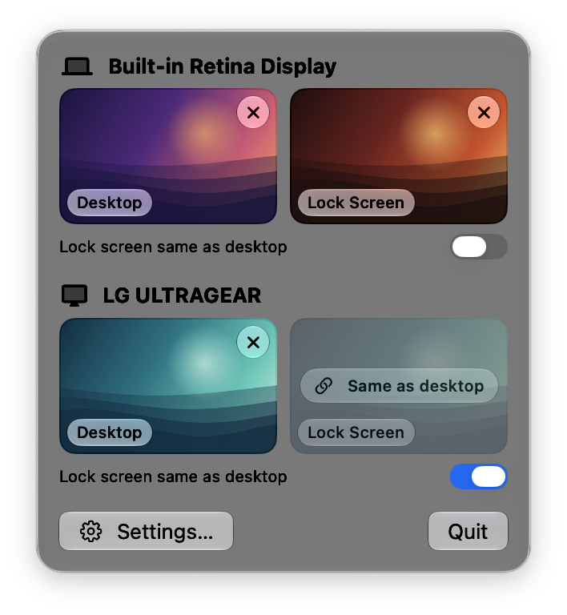
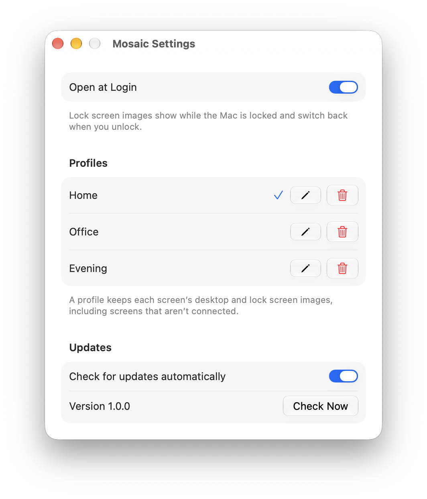

# Mosaic

A small macOS menu bar app that gives each connected screen its own
wallpaper, with an optional separate lock screen image per screen.

<p align="center">
  
  
</p>

- Click a tile in the menu bar panel to pick an image; the × clears it, and
  Undo (⌘Z) in the panel puts it back.
- Or drag an image onto the menu bar icon: a shelf with every screen's tiles
  opens under it, and you drop the image on a tile.
- A screen with no lock screen image shows its desktop image when locked.
  "Lock screen same as desktop" does the same while keeping the chosen lock
  image for when it's turned off.
- Profiles save the images for every screen under a name. Switch or save them
  from the menu at the top of the panel; rename or delete them in Settings….
  A screen a profile leaves empty keeps whatever wallpaper it already had.
- Settings… has Open at Login (`SMAppService`).
- Runs on notifications only (lock/unlock, Space change, wake, screen
  changes), with no polling. Previews are downsampled with ImageIO.
- UI uses SwiftUI Liquid Glass (`.glassEffect`, `.buttonStyle(.glass)`).

How the lock screen works, and the private pieces it needs, are described in
[docs/PRIVATE_APIS.md](docs/PRIVATE_APIS.md). The experiments behind it are in
[Spikes/](Spikes/README.md).

## Install
1. Download `Mosaic-<version>.dmg` from
   [Releases](https://github.com/yb1997/Mosaic/releases), open it, and
   drag Mosaic to Applications.
2. The app isn't notarized, so macOS blocks the first launch. Allow it in
   System Settings → Privacy & Security → Open Anyway, or run:
   ```bash
   xattr -dr com.apple.quarantine /Applications/Mosaic.app
   ```
3. Open it, then turn on Settings… → Open at Login.

## Updates
The app checks GitHub's latest release once a day (at launch
and after waking) and shows a banner in the menu panel when a newer version is
out. **Install** downloads the release's DMG, checks that the app inside is
signed with the same certificate as the running copy and has a higher version
in its own Info.plist, swaps it in place (asking for an administrator password
only if the folder isn't writable) and restarts. Updates downloaded this way
skip the Gatekeeper prompt. Settings → Updates has Check Now and a switch for
the daily check.

The updater refuses to run from a disk image, from a translocated copy (an app
opened from Downloads without moving it) and from ad-hoc signed builds.

Changes are listed in [CHANGELOG.md](CHANGELOG.md). Versions follow
[Semantic Versioning](https://semver.org).

## Signing
Releases are signed with a self-signed code-signing certificate named
`FreeDisplay Local` (shared with FreeDisplay). The updater pins it: a release
signed with any other certificate won't install over an existing copy, so keep
a backup of it (Keychain Access → right-click the certificate → Export as
`.p12`).

Local builds are ad-hoc signed unless `Config/Signing.local.xcconfig` names a
certificate:
```bash
cp Config/Signing.local.xcconfig.example Config/Signing.local.xcconfig
```

## Release
1. Move the `[Unreleased]` notes in `CHANGELOG.md` under `## [X.Y.Z] - date`.
2. Set `MARKETING_VERSION` in `project.yml` to `X.Y.Z` and bump
   `CURRENT_PROJECT_VERSION`; commit.
3. Run `./scripts/release.sh vX.Y.Z`. It checks the version and changelog,
   builds and signs the app, packages `Mosaic-X.Y.Z.dmg`
   (`scripts/build-dmg.sh`), pushes `main` and publishes the GitHub release
   with that DMG and the changelog section as notes.

To test the updater without publishing anything, build a Debug copy with a
lower version, put it outside /Applications and point it at a local DMG:
```bash
xcodebuild -project Mosaic.xcodeproj -scheme Mosaic -derivedDataPath build-test MARKETING_VERSION=0.9.0 build
MOSAIC_UPDATE_TEST_DMG=file://$PWD/Mosaic-X.Y.Z.dmg <copy>/Mosaic.app/Contents/MacOS/Mosaic -testInstallUpdate
```

## Build
Requires macOS 26+, Xcode 27 and [XcodeGen](https://github.com/yonaskolb/XcodeGen).

```bash
xcodegen generate
xcodebuild -project Mosaic.xcodeproj -scheme Mosaic -derivedDataPath build build
open build/Build/Products/Debug/Mosaic.app
```

To check the menu panel layout without clicking the menu bar, run a Debug
build with `-snapshotMenu out.png`, and add `-fakeDisplays N` to pretend there
are N screens:

```bash
build/Build/Products/Debug/Mosaic.app/Contents/MacOS/Mosaic -snapshotMenu /tmp/menu.png -fakeDisplays 4
```

For screenshots with sample images, run a Debug build with
`CFFIXED_USER_HOME` pointing at a folder holding sample
`Library/Application Support/Mosaic` data, plus `-keepWallpapers YES` so it
never changes the real wallpapers.

Images and settings live in `~/Library/Application Support/Mosaic/`.
